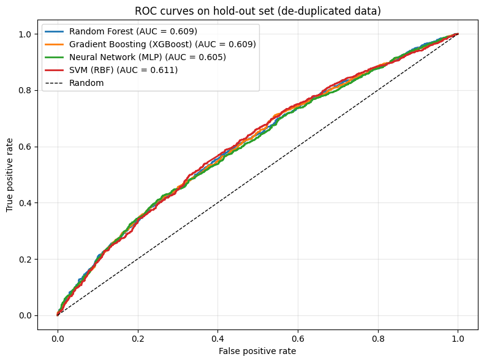
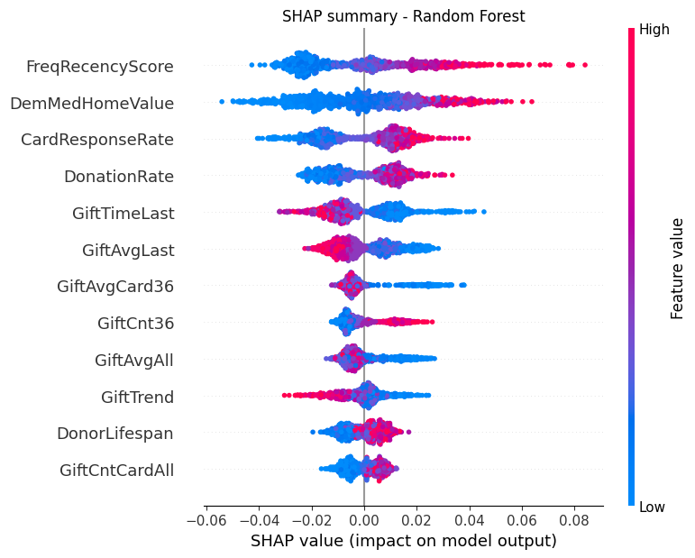

# Which donors will respond to a direct-mail appeal? — and why the first answer was wrong

  

A non-profit wants to mail only the prospects most likely to donate. This project compares four classifiers — Random Forest, XGBoost, a neural network and an SVM — to rank donors by response probability, then uses SHAP to explain what drives response.

**The most important result is a data-quality finding.** The first models scored an AUC of **0.976**. Before trusting that, I tested the data and found every donor profile had been **replicated ~11 times**, with **99.9%** of the validation set also present in training. The models were recognising people they had already seen. After de-duplication and proper cross-validation, the honest AUC is **0.61** — a modest but real signal, and the one this repository reports.

---

## Data

Donor records from a national veterans' charity (PVA), used as a teaching dataset. The target `TARGET_B` is 1 if the donor gave to the campaign. Gift amount (`TARGET_D`) is excluded because it is only known after the donor responds.

| Group | Example fields | What they capture |
|---|---|---|
| Giving history | `GiftCnt36`, `GiftCntAll`, `GiftAvgLast`, `GiftAvgAll` | How often and how much the donor has given |
| Recency | `GiftTimeLast`, `GiftTimeFirst` | Months since last and first gift |
| Promotion exposure | `PromCnt12`, `PromCntAll`, `PromCntCardAll` | How often the donor has been contacted |
| Donor status | `StatusCat96NK`, `StatusCatStarAll` | Charity's own donor tier |
| Demographics | `DemAge`, `DemGender`, `DemHomeOwner` | Individual characteristics |
| Neighbourhood | `DemMedHomeValue`, `DemMedIncome`, `DemPctVeterans` | Area-level wealth and profile |

### Engineered features

Six RFM-style features were built from pre-campaign history only, so none can leak the outcome.

| Feature | Formula | Idea |
|---|---|---|
| `FreqRecencyScore` | GiftCnt36 ÷ (GiftTimeLast + 1) | Recent, frequent givers score high |
| `CardResponseRate` | GiftCntCardAll ÷ (PromCntCardAll + 1) | Responsiveness to card promotions |
| `DonationRate` | GiftCntAll ÷ (PromCntAll + 1) | Gifts per contact — overall conversion |
| `GiftTrend` | GiftAvg36 ÷ (GiftAvgAll + 1) | Recent gift size vs lifetime average |
| `CardPromRatio` | PromCntCardAll ÷ (PromCntAll + 1) | Share of contacts that were card promotions |
| `DonorLifespan` | GiftTimeFirst − GiftTimeLast | Length of the giving relationship |

---

## 1. Finding the leakage

| Check | Result |
|---|---|
| Rows in supplied file | 106,546 |
| Distinct donor profiles | **9,686** (each repeated ~11×) |
| Validation rows identical to a training row | **99.9%** |
| Duplicate groups with a consistent target | 100% |
| Random Forest AUC on the original split | 0.976 |
| AUC change when any single top feature is removed | < 0.01 |

No single feature carried the answer — removing any of the top five barely moved the AUC. The inflation came from memorisation: a deep Random Forest could match each validation row to its identical copy in training. On a synthetic test where the target was **purely random** and each row was copied three times, the same pipeline still scored AUC ≈ 0.97, while AUC on unseen rows was ≈ 0.50, confirming the mechanism.

This also explains a puzzle in the original results: the SVM scored worst (AUC 0.70) because it was the model *least* able to memorise individual rows.

Check script: [`src/leakage_check.py`](src/leakage_check.py)

---

## 2. Corrected evaluation

The data were reduced to one row per distinct profile (9,686 donors, 50% responders). All four models were evaluated with **5-fold stratified cross-validation**, with median imputation and scaling fitted inside each fold so no information crosses folds.

| Model | CV AUC (mean ± sd) | Accuracy | F1 | Hold-out AUC | Hold-out KS |
|---|---|---|---|---|---|
| **SVM (RBF)** | **0.615 ± 0.012** | 0.583 | 0.571 | 0.611 | 0.172 |
| Random Forest | 0.610 ± 0.009 | 0.577 | 0.561 | 0.609 | 0.159 |
| Gradient Boosting (XGBoost) | 0.607 ± 0.010 | 0.580 | 0.568 | 0.609 | 0.169 |
| Neural Network (MLP) | 0.595 ± 0.014 | 0.568 | 0.563 | 0.605 | 0.163 |

**Before vs after the fix**

| | Original evaluation | Corrected evaluation |
|---|---|---|
| Rows used | 106,546 (duplicated) | 9,686 (distinct donors) |
| Validation design | Fixed partition, 99.9% overlap with training | 5-fold stratified CV + 30% hold-out |
| Imputation fitted on | Full dataset | Training folds only |
| Best AUC | 0.976 (Random Forest) | 0.615 (SVM) |
| Worst model | SVM, AUC 0.699 | MLP, AUC 0.595 |
| Precision in top 20% | 99.9% | 64.0% |

The four models are **statistically close**: the gap between SVM and Random Forest (0.005) is smaller than one standard deviation across folds. Model choice matters far less than the data itself.



---

## 3. Does the model help targeting?

Hold-out set (2,906 donors, 50% base response rate), ranked by the SVM:

| Mail to | Contacted | Responders | Response rate | Lift | Share of all responders |
|---|---|---|---|---|---|
| Top 10% | 290 | 191 | 65.9% | 1.32× | 13.1% |
| Top 20% | 581 | 372 | 64.0% | 1.28× | 25.6% |
| Top 30% | 871 | 536 | 61.5% | 1.23× | 36.9% |
| Top 50% | 1,453 | 846 | 58.2% | 1.16× | 58.2% |

Mailing the top 20% raises the response rate from 50% to **64%**. The benefit is real but modest, so the model is best used to **cut the lowest-scoring prospects** from expensive mail rather than to promise precise targeting.

The dataset was balanced to 50/50 responders; real campaign response rates are far lower, so these precision figures would need recalibration before use.

---

## 4. What drives response?

SHAP values were computed on the Random Forest. It performs within one standard deviation of the SVM, and tree-based SHAP is exact and fast, whereas kernel SHAP on an SVM is approximate and slow.

| Rank | Feature | Meaning | Mean \|SHAP\| |
|---|---|---|---|
| 1 | **FreqRecencyScore** *(engineered)* | Gifts in last 36 months ÷ months since last gift | 0.0199 |
| 2 | DemMedHomeValue | Median home value in the donor's neighbourhood | 0.0181 |
| 3 | **CardResponseRate** *(engineered)* | Card-promotion gifts ÷ card promotions received | 0.0146 |
| 4 | **DonationRate** *(engineered)* | All gifts ÷ all promotions received | 0.0119 |
| 5 | GiftTimeLast | Months since last gift | 0.0112 |

Three of the top four predictors are RFM-based features I engineered, showing that recent, frequent and promotion-responsive giving predicts response better than any raw field.



---

## 5. Recommendations

1. **Use the score to drop the bottom of the list, not to pick a narrow top.** With lift around 1.3×, the clearest saving is to stop mailing the lowest-scoring prospects.
2. **Prioritise recent, frequent, card-responsive donors** — the strongest and most stable signals.
3. **Add area-level wealth data** (e.g. census or postcode income) to prospect lists; neighbourhood home value is the second-strongest predictor.
4. **Collect richer data before investing in more complex models.** Four very different algorithms all plateau near AUC 0.61, so the limit is the information available, not the model.

---

## Lessons

- An AUC near 0.98 on a marketing-response problem is a reason to investigate, not to celebrate.
- Always check for duplicate records across train and test partitions — especially in teaching or pre-partitioned datasets.
- Fit imputation and scaling inside cross-validation folds, not on the full dataset.

## Limitations
- Results come from a balanced teaching dataset; absolute response rates do not reflect a live campaign.
- Hyperparameters were set sensibly but not exhaustively tuned; given how closely the models agree, tuning is unlikely to change conclusions.
- SHAP shows association with predicted response, not causal effects of contacting a donor.

---

## Repository structure

```
├── src/
│   ├── leakage_check.py          duplicate and leakage diagnostics
│   └── donor_response_dedup.py   de-duplication, cross-validation, targeting, SHAP
├── outputs/                      targeting table and SHAP importance (CSV)
├── figures/                      ROC curves and SHAP summary
└── README.md
```

The source dataset (PVA donor data, used for teaching) is not redistributed. To reproduce, place `pva_partition.csv` next to the scripts and run them in order.

## Tools
Python · pandas · scikit-learn · XGBoost · SHAP · matplotlib
